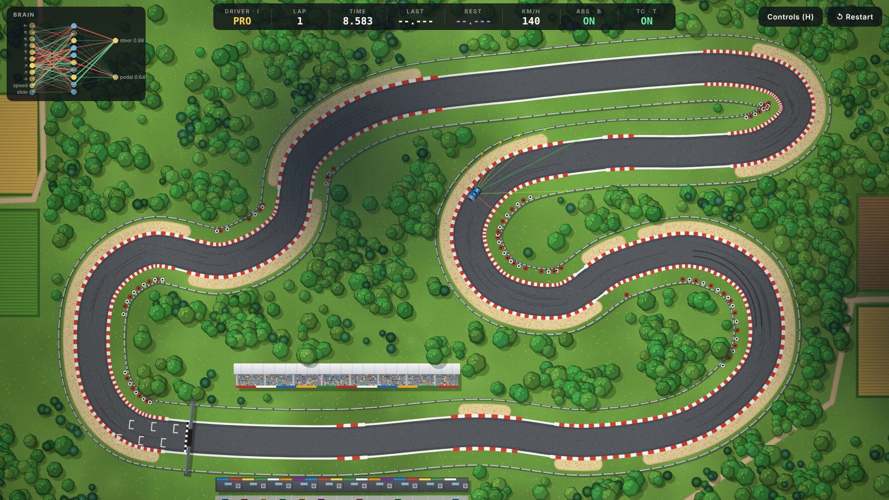
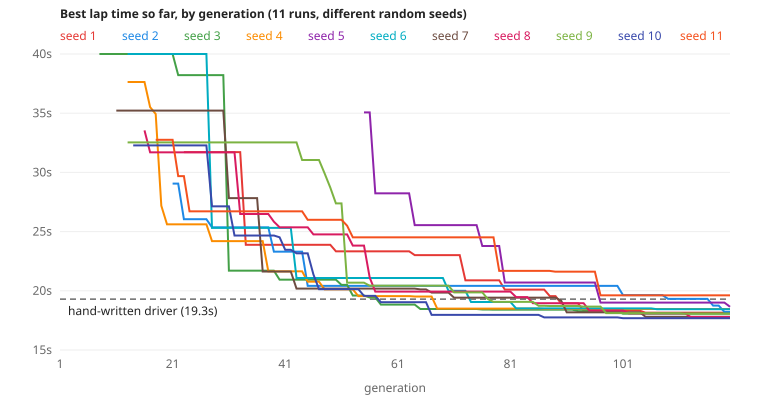

# Self Steer

A top-down racing game where cars teach themselves to drive.



You can drive the car yourself, hand it to an AI, race against the AI, or watch 50 AI cars learn
the circuit from scratch. Each AI car is controlled by a small neural network, and the networks
are improved by a genetic algorithm: the drivers that get furthest are bred together, mutated a
little, and raced again. Everything is plain JavaScript with no libraries, including the network.

## Running it

There's no build step, but it uses ES modules so it needs to be served rather than opened as a file:

```bash
python3 -m http.server 8000
```

Then open http://localhost:8000.

## Controls

| Key | Action |
| --- | --- |
| W / ↑ | Accelerate |
| S / ↓ | Brake (reverse once stopped) |
| A / ← | Steer left |
| D / → | Steer right |
| B | Toggle ABS |
| T | Toggle traction control |
| R | Restart (replays the start lights) |
| I | Hand the car to the best trained AI |
| N | Hand the car to an untrained AI, to see where it starts from |
| P | Race against the best trained AI |
| G | Training mode: watch 50 AI cars evolve |
| F | Change training speed (1x, 3x, 10x) |
| C | Chase cam |
| V | Show the distance sensors |
| H | Show or hide the controls |

## How it works

**The track** is 26 hand-placed points smoothed into a loop with a Catmull-Rom spline and sampled
into evenly spaced points along the centre line. Almost everything is worked out from the distance
to that centre line: whether you're on the road, where the barriers are, what the sensors see and
how far round the lap you are. Finding the nearest point only searches near where the car was last
frame, which is about 7x faster than checking the whole loop.

**The car** has a simple but believable physics model. The tyres have a grip budget that braking,
accelerating and cornering all share, split between the axles by weight transfer. Ask for more than
the front tyres have and the car understeers; run out at the rear and it oversteers. Braking harder
than the tyres can take locks the wheels so you can't steer, unless ABS is on. Too much throttle
spins the rear wheels, unless traction control is on. The car hits steel barriers rather than
driving off into the countryside.

**The AI** sees the track through nine rays that measure the distance to the barrier, plus its own
speed and how much it's sliding. Those 11 numbers go into a neural network (11 → 10 → 2, tanh
activations), which outputs a steering value and a single pedal: positive for throttle, negative
for brake. The rays use sphere tracing, so each one only needs about ten distance checks.

**Evolution** races 50 cars at once with ABS and traction control off, so they have to learn car
control themselves. A car is out if it hits a barrier, goes backwards or stalls. Its fitness is how
far round the track it got, plus a bonus for fast laps once it can complete one. The top two brains
carry over unchanged, and the rest are bred from tournament-selected parents using uniform crossover
and Gaussian mutation. The circuit is used both ways round during training, so the AI can't get
away with only being good at turning one way. See [Results](#results) for how well that works.

## Training your own driver

Press G in the game to watch the cars evolve, and F to speed it up. The best driver found is saved
in your browser, and I or P will use it if it's faster than the one that ships with the game.

Training is much faster without the browser:

```bash
npm run train -- 120 models/pro.json
```

The third argument is a random seed, so a run can be repeated exactly. The included
`models/pro.json` is seed 3 from the runs below.

## Results

All of these numbers come from scripts in `tools/` and can be regenerated.

### Against a hand-written driver

The baseline (`tools/handDriver.mjs`) is a driver I wrote by hand. It gets to cheat: it knows the
shape of the whole track, works out the safe speed for every corner from its radius and brakes in
time for it. The AI only has its nine sensors, its speed and how much it's sliding.

Best lap over a two-minute race (`node tools/evaluate.mjs`; full table in
[docs/evaluation.md](docs/evaluation.md)):

| Track | Hand-written, no aids | AI, no aids |
| --- | --- | --- |
| main (trained on) | 19.30s | **18.10s** |
| main, reversed (trained on) | 19.00s | **18.18s** |
| mirrored (never seen) | 19.00s | **18.38s** |
| kidney (never seen) | 11.93s | **11.47s** |
| kidney, reversed (never seen) | 11.72s | **11.07s** |
| technical (never seen) | 17.33s | gets stuck at 89% of the lap |
| technical, reversed (never seen) | 16.28s | one 13.60s lap, then gets stuck |

### Is it learning to drive, or memorising the track?

The AI never sees its position, only distances to the barrier, so it can't memorise coordinates.
It can still overfit to the kind of corners it practised on, and it did:

- **The first version only trained on the circuit one way round.** About 70% of that circuit's
  corners turn the same way. It beat the hand-written driver on the mirrored circuit and on the
  kidney, but driving the training circuit the other way round it couldn't get past a tight
  hairpin in its weaker direction. It had learned to turn one way better than the other.
- **Training on the circuit both ways round fixed that.** Five layouts are held out and never
  trained on: the mirrored circuit, and two new circuits (kidney and technical) each driven both
  ways. Counting a win as "completed at least as many laps and set a faster best lap", the four
  runs that trained properly (see below) beat the hand-written driver in **9 of 12** cases on the
  three layouts whose corners resemble the training circuit (mirrored, kidney both ways), **0 of 8**
  on the technical track, and **9 of 20** overall. Per-run tables are in
  [docs/evaluation.md](docs/evaluation.md).
- **It still can't handle a corner much tighter than anything it practised on.** The technical
  track has a hairpin with a 22px radius; the tightest in training is 38px. Every run struggles
  there. The pro driver brakes to a stop facing the barrier and never moves again, because it
  never learned to reverse out (cars that go backwards are eliminated in training). Training on
  more varied circuits, including tighter hairpins, is the obvious next step.

### Is evolution repeatable?

Five training runs, 120 generations each, identical apart from the random seed
(`node tools/train.mjs 120 <file> <seed>`, charted with `node tools/curves.mjs`):



| Seed | First lap at generation | Best lap by gen 30 | by gen 70 | by gen 120 |
| --- | --- | --- | --- | --- |
| 1 | 23 | 31.72s | 23.02s | 18.15s |
| 2 | 21 | 25.37s | 20.42s | 18.22s |
| 3 | 8 | 38.22s | 18.47s | 18.07s |
| 4 | 13 | 24.20s | 18.50s | 18.47s |
| 5 | 101 | - | - | 34.80s |

Four of the five runs end up between 18.07s and 18.47s, all faster than the hand-written driver,
though they get there at quite different speeds. Seed 5 got stuck: nothing in its population
found a lap until generation 101. With only 50 cars, a population can converge on a dead end, so
a few runs are worth doing rather than trusting one. The run data is in `docs/runs/`.

The pro driver is the run with the highest score on the training tracks (seed 3). It was picked
by that rule rather than by its results on the test tracks, which would have been cheating.

## Tests

```bash
npm test
```

The tests use Node's built-in test runner. They cover the maths helpers, the neural network, the
genetic operators, lap counting, the car physics (including ABS and the barriers), and check that
the pre-trained driver can still get round a lap cleanly. They run on every push with GitHub Actions.

## Project layout

- `src/main.js` - game loop, controls and modes; wires everything else together
- `src/track.js` - the circuit: spline, centre-line points, nearest point and barrier distance
- `src/car.js` - car physics
- `src/input.js` - turns keys into throttle, brake and steering
- `src/laps.js` - progress round the track and lap timing
- `src/sensors.js` - rays that measure the distance to the barrier
- `src/network.js` - the neural network
- `src/driver.js` - feeds the sensors into the network and turns its outputs into controls
- `src/genetics.js` - crossover, mutation and tournament selection
- `src/trainer.js` - runs a population of AI cars and breeds the next generation
- `src/brains.js` - loads the pre-trained driver and saves the best one you train
- `src/scenery.js`, `src/carSprite.js`, `src/effects.js`, `src/atmosphere.js`, `src/startLights.js`,
  `src/hud.js`, `src/panels.js` - everything you see: scenery, cars, effects, start lights, HUD,
  the fitness chart and the live network view
- `tools/train.mjs` - trains a driver in Node without the browser
- `tools/tracks.mjs` - the training circuits and the test circuits the AI never trains on
- `tools/handDriver.mjs` - the hand-written baseline driver
- `tools/evaluate.mjs` - races the AI and the baseline on every track
- `tools/curves.mjs` - charts several training runs
- `models/pro.json` - the pre-trained driver
- `docs/` - evaluation results, training runs and the chart
- `tests/` - unit tests

The simulation code never touches the canvas, which is what lets the same physics and AI run in
the browser, in the tests and in the training script.

## Things it doesn't do (yet)

- The physics is an arcade model, not a full simulation: no tyre slip curves or yaw inertia.
- The AI handles new circuits with similar corners well, but not corners much tighter than any it
  trained on, and it can't reverse out of trouble.
- Cars don't collide with each other.
